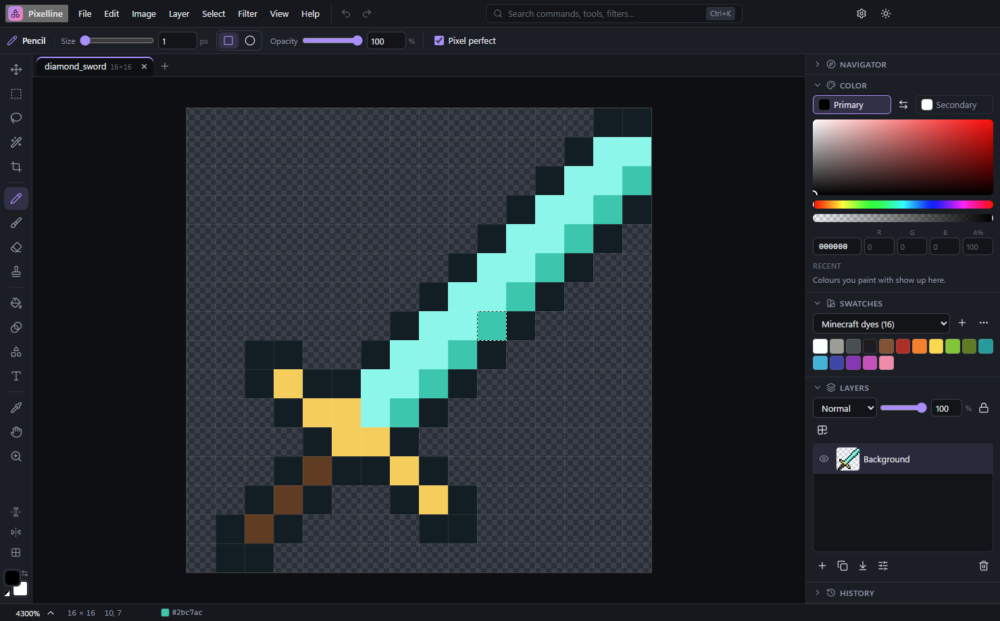

# Pixelline

**A free, fast image editor for Windows, made for pixel art and game textures.** Draw Minecraft resource-pack textures, sprites and icons with pixel-perfect tools, or edit photos with layers, selections, filters and adjustments. It opens and saves PNG, JPEG, WebP, OpenRaster (`.ora`) and Photoshop (`.psd`) files.

Pixelline is a sister app of [Gridline](https://github.com/LucasHeh47/gridline) and shares its look.

## Download and install

1. Go to the **[releases](https://github.com/LucasHeh47/pixelline/releases)**.
2. Under **Assets**, download one of these files:

   | File | What it is |
   | --- | --- |
   | **`Pixelline-Setup-x.y.z.exe`** | **The installer (recommended).** It adds Pixelline to the Start menu and the desktop, opens images with a double-click, and updates itself. |
   | `Pixelline-Portable-x.y.z.exe` | A single file you can run from anywhere without installing. It doesn't update itself; it tells you when a new version is available. |

3. Run the file you downloaded.

> **"Windows protected your PC"?** Pixelline isn't signed with a paid code-signing certificate, so Windows SmartScreen may warn you the first time. Click **More info**, then **Run anyway**. Only download Pixelline from this repository's Releases page.

**Requirements:** Windows 10 or 11 (64-bit).

## What it does

**For pixel art and textures**

- **Pencil with pixel-perfect lines**: no doubled corners on curves, square or round tips, Shift+click for straight lines.
- **Seamless tile preview** (Shift+T): the image repeats around itself, and painting wraps around the edges, so block textures tile without seams.
- **Mirror painting** left-right and top-bottom, a **pixel grid** and a **tile grid** (every 16 pixels, or any size).
- **Palettes**: Minecraft dyes, PICO-8, DawnBringer 16, Endesga 32, Game Boy and more. Make your own from an image's colours, or import and export GIMP/Aseprite `.gpl`, `.pal`, `.hex` and Paint.NET palettes.
- **Turn into pixel art**: shrinks a photo or drawing to a few pixels with a limited palette. It's a quick way to start a texture.
- **Reduce colours** to any palette, with or without dithering (Floyd–Steinberg, Atkinson, ordered).
- **Upscale pixel art** with Scale2x/Scale3x (smooth diagonals, no blur), for example to turn a 16× texture into a 32× one.
- **Replace colour** to recolour a texture in one go, optionally keeping its shading.
- **Shade and dither inks**: paint shading (each pixel a darker or lighter, hue-shifted shade of itself) or dither patterns with the pencil or brush.
- **Animated textures** with a live preview, onion skin, frame tools, and the **.png.mcmeta** saved for you.
- **Batch process a whole folder** (a resource pack): upscale, resize, recolour, filter or convert every texture at once. **Export tiles** splits an atlas into separate PNGs, and **snap to the tile grid** keeps selections and moves on whole tiles.
- New-image sizes for Minecraft blocks and items (16×–128×), skins, pack icons, GUIs, paintings and animated textures.
- PNG files are saved exactly, and as small paletted PNGs when they have 256 colours or fewer.

**For photos and bigger images**

- **Layers** with 16 blend modes, opacity, locks and a "lock transparent pixels" switch; drag to reorder; merge, flatten, duplicate.
- **Selections**: rectangle, ellipse, lasso (free and polygon), magic wand, with add/subtract/intersect, feathering, grow and shrink.
- **Free transform** (Ctrl+T): scale, rotate and flip a layer or the selected pixels, with hard-pixel or smooth resampling.
- **Brushes** with hardness, flow, smoothing and pen pressure; eraser; clone stamp; fill bucket; five kinds of gradients (with dithering); shapes; text.
- **Adjustments**: curves (with a curve editor), auto tone, levels, brightness/contrast, hue/saturation, colour balance, exposure, vibrance, gradient map, black & white, invert, posterize, threshold.
- **Retouch brush**: blur, sharpen, lighten, darken or change colour strength just where you paint.
- **Filters** with a live preview: blurs, sharpen, noise, despeckle, emboss, find edges, vignette, pixelate, outline, colour to transparency, offset and "make seamless".
- Image size (nearest, bilinear, bicubic and averaging), canvas size with an anchor, crop, trim, rotate and flip.
- **Undo history** that only stores what changed, so it stays small even on big photos.

**Everyday things**

- Several images in tabs, drag and drop, copy and paste with other apps.
- **Export as** PNG, JPEG or WebP at any scale, showing the file size before you save.
- Every command is searchable with **Ctrl+K**, and has the keyboard shortcuts you know from other editors (B, E, V, M, Ctrl+T, Ctrl+J…).
- **Safety copies** of unsaved work, offered back after a crash.
- Part of a family: the app switcher opens **Gridline** (spreadsheets) and **Baseline** (a home for your apps and files).
- Dark and light themes and accent colours.

## Learn more

- **[User guide](docs/user-guide.md)**: tools, layers, pixel-art features and keyboard shortcuts.
- **[What's new](CHANGELOG.md)**: changes in each version.
- **[Developing Pixelline](docs/development.md)**: building it from source.

## Updates

The installed app checks for new versions when it starts and asks before installing anything. You can turn this off in **Settings → Updates**.

**Developer branch:** to try new features first, turn on **Settings → Updates → Developer branch**. You'll get development builds, which are built automatically from the `develop` branch and may have bugs.

## Privacy

Pixelline doesn't collect analytics or send your images anywhere, and there is no account. It only goes online to check this repository's GitHub Releases for updates.

## License

[MIT](LICENSE)
